<div align="center">

# TmapNda

**콤마(openpilot)에 티맵·카카오내비·네이버 길안내 정보를 실시간으로 전달해 주는 안드로이드 앱**

과속카메라, 구간단속, 방지턱, 제한속도, 다음 회전 정보를 콤마에 알려줘서 길 상황에 맞게 속도를 조절하도록 도와줍니다.

[](https://github.com/Rusiperso/TmapNda/releases)
[](https://github.com/Rusiperso/TmapNda/releases)
[](https://discord.gg/eQhbvUVWKv)

</div>


> **처음이신가요?** 아래 [한눈에 보는 시작 순서](#한눈에-보는-시작-순서)만 위에서부터 따라 하면 됩니다. 막히면 [문제 해결](#문제-해결-표)에서 증상으로 찾아보세요.

---

## 목차

**시작하기**
1. [TmapNda가 뭔가요?](#tmapnda가-뭔가요)
2. [한눈에 보는 시작 순서](#한눈에-보는-시작-순서)
3. [앱 설치하기](#앱-설치하기)
4. [키(열쇠) 발급받기](#키열쇠-발급받기)
5. [처음 실행하고 연결 확인하기](#처음-실행하고-연결-확인하기)

**쓰는 법**

6. [설정 켜고 끄는 법](#설정-켜고-끄는-법)
7. [화면 구성](#화면-구성)
8. [목적지 찾고 출발하기](#목적지-찾고-출발하기)
9. [즐겨찾기·집·회사](#즐겨찾기집회사)
10. [주변 검색 (주유소·충전소 등)](#주변-검색-주유소충전소-등)
11. [안전 정보 (카메라·사고·공사)](#안전-정보-카메라사고공사)
12. [인터넷 없이 쓰기 (미리 받기)](#인터넷-없이-쓰기-미리-받기)
13. [음성 명령](#음성-명령)
14. [그 밖의 기능](#그-밖의-기능)

**막혔을 때**

15. [문제 해결 표 (SDK 오류 포함)](#문제-해결-표)
16. [자주 묻는 질문](#자주-묻는-질문)
17. [버그 신고와 로그](#버그-신고와-로그)
18. [커뮤니티](#커뮤니티)

---

## TmapNda가 뭔가요?

폰에서 돌아가는 내비게이션 도우미 앱입니다. 폰이 길 정보를 모아서 같은 와이파이에 있는 콤마에게 알려줍니다.

- 화면 위쪽에 **속도 / 제한속도 / 콤마 연결 상태 / GPS 상태 / 검색창 / 메뉴**가 항상 떠 있습니다.
- 목적지를 검색하면 **카카오내비** 또는 **네이버** 중 고른 쪽의 길안내 화면으로 넘어갑니다. (둘 중 하나만 고르면 됩니다)
- 과속카메라·구간단속·방지턱 같은 안전 정보는 티맵에서 받아 콤마에 전달합니다.
- 순정 티맵이나 차량 순정 내비와 **충돌하지 않습니다.** 따로따로 동작합니다.
- 최신 앱 파일(APK)은 [Releases 페이지](https://github.com/Rusiperso/TmapNda/releases)에서 받습니다.

---

## 한눈에 보는 시작 순서

| 순서 | 할 일 | 걸리는 시간 | 자세히 |
|:---:|---|:---:|---|
| 1 | APK 받아서 설치 (갤럭시는 막는 곳이 2군데) | 5분 | [앱 설치하기](#앱-설치하기) |
| 2 | **티맵 키** 발급 (필수) | 10분 | [티맵 키](#1-티맵-키-필수) |
| 3 | **카카오 키** 또는 **네이버 키** 발급 (길안내 쓸 쪽만) | 10분 | [카카오](#2-카카오-키-카카오-길안내용) / [네이버](#3-네이버-키-네이버-길안내용) |
| 4 | 앱 첫 화면에 키 붙여넣기, **내 닉네임** 입력 | 2분 | [처음 실행](#처음-실행하고-연결-확인하기) |
| 5 | 폰을 콤마와 **같은 와이파이**에 연결 → 상단에 `Comma 연결됨` 확인 | 1분 | [연결 확인](#처음-실행하고-연결-확인하기) |
| 6 | (선택) 오피넷·전기차 충전소 키 | 각 10분 | [선택 키](#4-오피넷-키-선택) |

> 키는 모두 **무료**입니다. 다만 네이버는 결제 카드 등록이 필요합니다 (무료 사용량 안에서는 돈이 나가지 않습니다).

---

## 앱 설치하기

TmapNda는 구글 플레이스토어에 없고 APK 파일로 직접 설치합니다. 안드로이드는 스토어 밖의 앱을 기본으로 막아 두기 때문에 **설치할 때만 잠깐 풀었다가 되돌리면** 됩니다.

**갤럭시는 막는 곳이 두 군데입니다.** 하나만 풀면 설치가 안 됩니다. 순서대로 하세요.

### 1단계 — APK를 연 앱에 설치 권한 주기

1. [Releases 페이지](https://github.com/Rusiperso/TmapNda/releases)에서 최신 `TmapNda-vX.Y.Z.apk`를 내려받습니다.
2. 받은 APK 파일을 눌러 설치를 시작합니다.
3. **"권한 필요"** 팝업이 뜨면 **[설정]** 을 누릅니다.
4. **"출처를 알 수 없는 앱 설치"** 화면에서 **"권한 허용"** 스위치를 켜고 뒤로 갑니다.

> 💡 이 권한은 **APK를 연 앱마다 따로** 걸립니다. "내 파일"로 열었으면 내 파일에만, 크롬으로 열었으면 크롬에만 걸립니다.

### 2단계 — "보안 위험 자동 차단" 30분 끄기

1단계를 하고 APK를 다시 눌러도 이번엔 **"출처를 알 수 없는 앱 차단됨"** 팝업이 뜹니다.

1. 팝업의 **[확인]** 을 눌러 닫습니다. (설정으로 가는 버튼이 없어서 직접 설정 앱을 열어야 합니다)
2. 홈 화면에서 **[설정]** 앱 → **[보안 및 개인정보 보호]** → 아래쪽 **[보안 위험 자동 차단]** 을 누릅니다.
3. 맨 위 **"사용 중"** 스위치를 끕니다.
4. **"30분 후에 다시 켤까요?"** 가 뜨면 **[확인]** 을 누릅니다. (30분 뒤 자동으로 다시 켜지니 따로 되돌릴 필요 없습니다)
5. APK 파일을 다시 누르면 설치가 진행됩니다.

### 3단계 — 설치 후 되돌리기

설치가 끝나면 **1단계에서 켠 "권한 허용"만 다시 꺼 주세요.** ([설정 > 앱 > 내 파일(또는 APK를 연 앱) > 출처를 알 수 없는 앱 설치]) 이미 설치된 TmapNda는 그대로 잘 동작합니다.

**업데이트도 같습니다.** 새 APK를 받아 그 위에 설치하면 되고, 설정·즐겨찾기는 그대로 남습니다.

### 설치 중 막힐 때

| 증상 | 해결 |
|---|---|
| "Play 프로텍트에서 확인되지 않은 앱" 경고 | **[무시하고 설치]** 를 누릅니다. 스토어에 없는 앱이라 뜨는 안내입니다. |
| [무시하고 설치]가 안 보이거나 계속 멈춤 | 아래 "Play 프로텍트 잠깐 끄기"를 따라 합니다. |
| "앱이 설치되지 않았습니다" | 같은 앱이 다른 서명으로 이미 깔려 있을 수 있습니다. 기존 TmapNda를 지우고 다시 설치하세요. (먼저 [설정 백업](#설정-켜고-끄는-법)을 해 두면 복원할 수 있습니다) |
| 설치는 됐는데 앱이 안 열림 | 폰을 한 번 재부팅한 뒤 다시 열어 보세요. 그래도 안 되면 [버그 신고](#버그-신고와-로그) |

**Play 프로텍트 잠깐 끄기**

1. **Play 스토어** 앱 → 오른쪽 위 **프로필 사진 → [Play 프로텍트]**
2. 오른쪽 위 **톱니바퀴(⚙) → "Play 프로텍트 설정"**
3. **"Play 프로텍트로 앱 검사"** 스위치를 끕니다. (첫 번째 사진처럼 회색이면 꺼진 것)
4. 설치가 끝나면 **꼭 다시 켜 주세요.** [Play 프로텍트] 화면의 **[사용 설정]** (두 번째 사진) → 다시 ⚙로 가서 스위치가 파란색(켜짐)인지 확인 (세 번째 사진)

<p align="center">
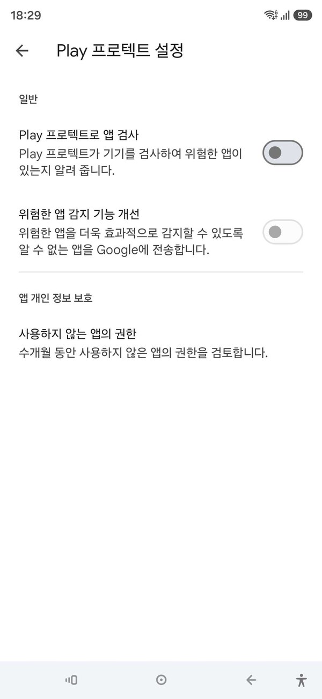
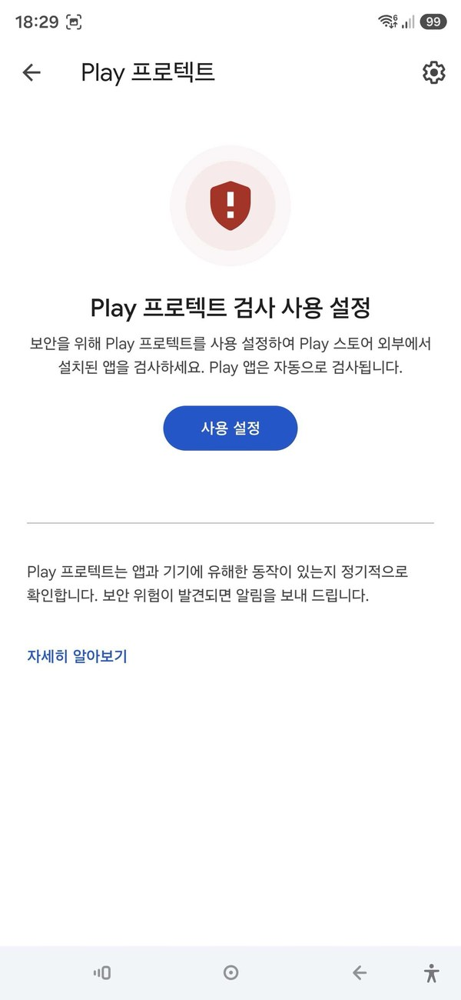
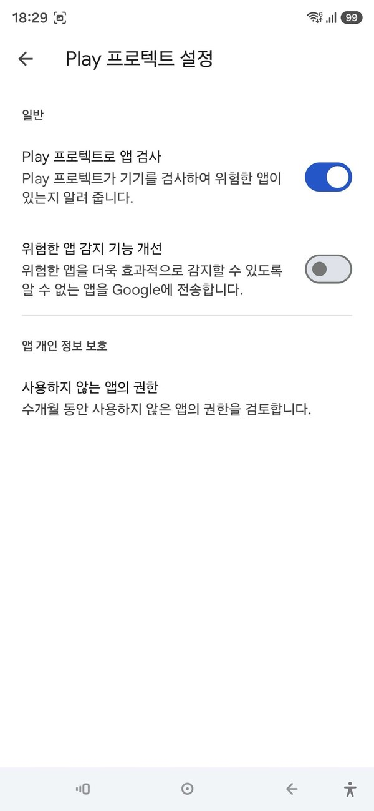
</p>

> 📷 사진으로 보면서 따라 하고 싶다면: [갤럭시 출처를 알 수 없는 앱 설치 및 차단 푸는 방법](https://blog.naver.com/nbnb112233/224322426411) (외부 블로그)

---

## 키(열쇠) 발급받기

"키"는 각 회사의 지도·길안내 서비스를 쓰게 해 주는 **긴 영문·숫자 암호**입니다. 아래 표에서 내가 필요한 것만 발급하면 됩니다. **PC 브라우저로 하는 걸 권장합니다.**

| 키 | 꼭 필요? | 어디서 | 용도 |
|---|:---:|---|---|
| ① 티맵 키 | **필수** | openapi.sk.com | 앱 실행, 장소 검색, 안전 정보 |
| ② 카카오 네이티브 앱 키 | 카카오로 길안내할 때 | developers.kakao.com | 카카오 길안내 |
| ③ 네이버 Key ID + Key Secret | 네이버로 길안내할 때 | ncloud.com | 네이버 길안내 |
| ④ 오피넷 키 | 선택 | opinet.co.kr | 주유소 브랜드·가격 |
| ⑤ 전기차 충전소 키 | 선택 | data.go.kr | 충전기 실시간 상태 |

> ②와 ③은 **둘 중 하나만** 있어도 됩니다. 목적지·주변 검색은 티맵이 하므로 따로 키가 필요 없습니다.

### 1. 티맵 키 (필수)

**1.** [openapi.sk.com](https://openapi.sk.com) 접속

**2.** 우측 상단 **로그인** → 티맵 계정으로 로그인 (따로 회원가입 불필요)

**3.** **대시보드 → 앱** 메뉴에서 앱 목록이 뜨면 우측 상단 **+ 앱 만들기** 클릭

<p align="center">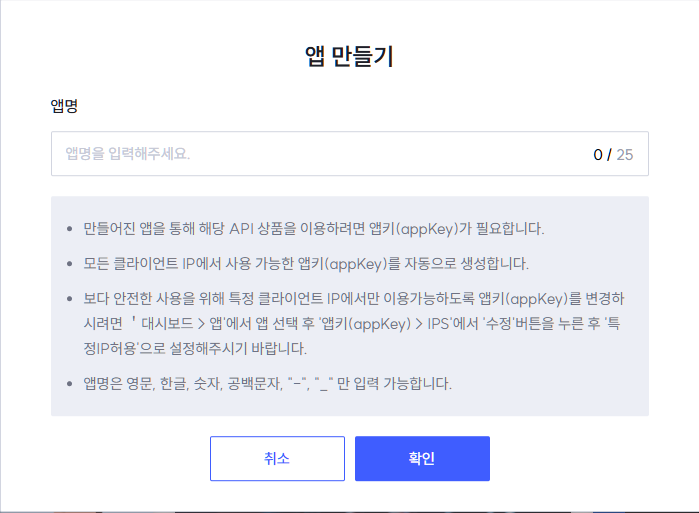</p>

**4.** 아래처럼 입력하고 약관에 모두 동의합니다.

| 항목 | 값 |
|---|---|
| 앱명 | 자유 입력 (예: 내차TmapNda) |
| 이용 API | `Tmap` 선택 |
| 사용요금제 | `무료` 선택 |

**5.** 앱이 비활성화 상태라면 만든 앱 → 설정 → 앱 상태 → **활성화**

<p align="center">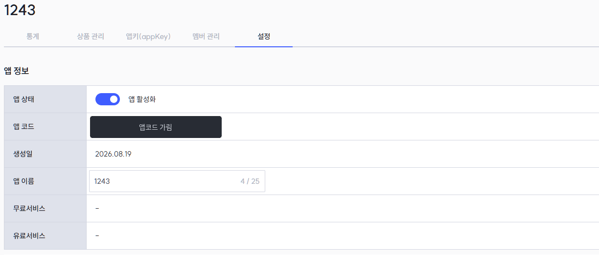</p>

**6.** 상단 **PRODUCTS → TMAP → API 사용요금**으로 가서 **Free(무료체험)** 카드의 **사용하기 → 신청하기 → 앱 신청** (보통 몇 분 안에 승인됩니다)

<p align="center">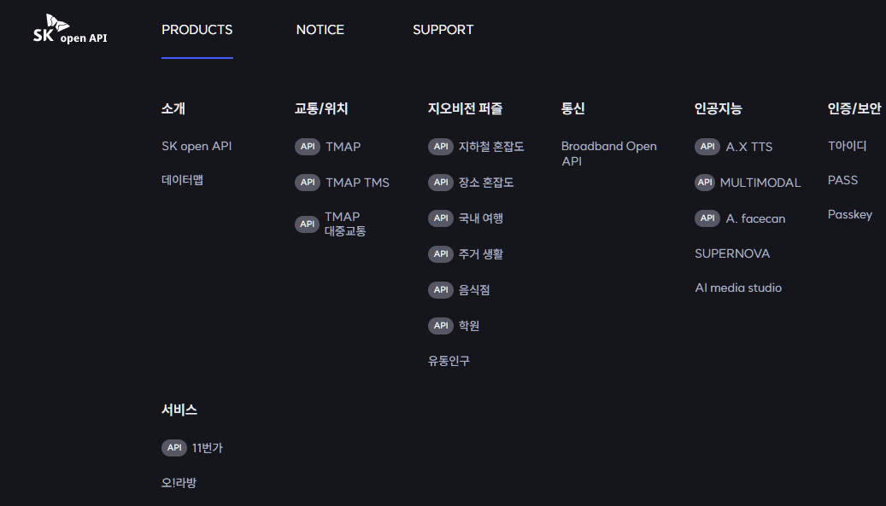</p>
<p align="center">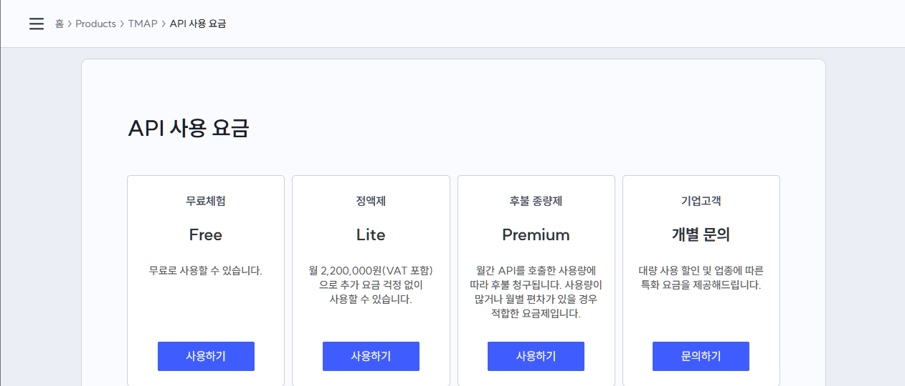</p>

**7.** 앱 목록에서 방금 만든 앱 → **앱키(appKey)** 탭 → 발급된 키를 복사 아이콘으로 전체 복사 (예시 화면은 키를 가렸습니다)

<p align="center">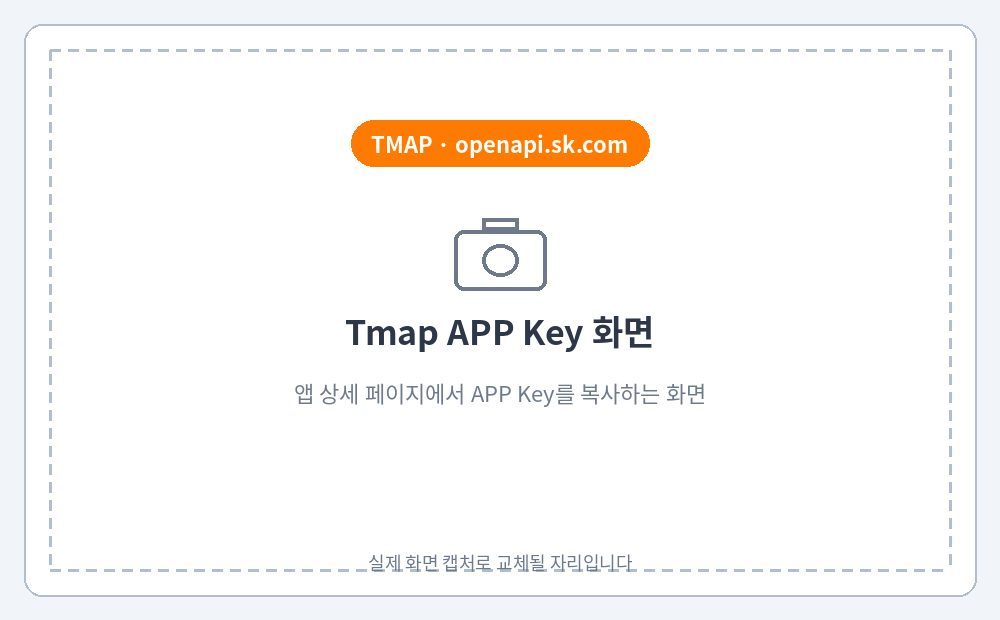</p>

**8.** TmapNda 첫 화면(안전운행 시작하기)의 앱키 칸에 붙여넣고 저장합니다. 이미 한 번 실행했다면 **≡ 메뉴 → 설정을 길게 누르면** 이 화면으로 다시 갑니다.

### 2. 카카오 키 (카카오 길안내용)

**1.** [developers.kakao.com](https://developers.kakao.com) → 카카오 계정으로 로그인 → 상단 **앱** → 우측 상단 **+ 앱 생성** (심사 없이 바로 만들어집니다)

| 항목 | 값 |
|---|---|
| 앱 아이콘 | 생략 가능 |
| 앱 이름 * | 자유 입력 (예: TmapNda) |
| 회사명(사업자명) * | 개인이면 아무 문자열 |
| 카테고리 | 지도/내비게이션 (또는 자유 선택) |

<p align="center">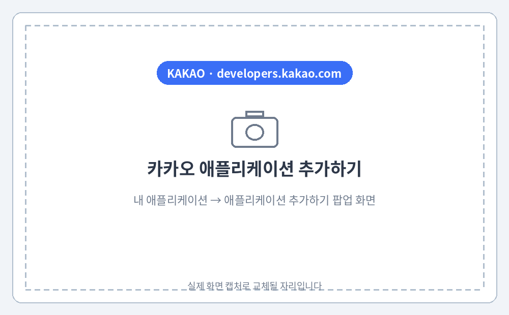</p>

**2.** 만든 앱을 열고 **아래 두 가지를 모두** 합니다. 하나라도 빠지면 카카오 길안내가 켜지지 않습니다.

**① 플랫폼 키 등록** — 좌측 **앱 → 플랫폼 키 → 네이티브 앱 키(Default Native AppKey)** 를 눌러 열고, 아래로 내려 **Android 앱 정보**에 다음 값을 **그대로 복사해서** 저장합니다.

```
패키지명: com.tmap.nda
키 해시: zQSvbNffsYGnbQksdHmIUbe10V0=
```

<p align="center">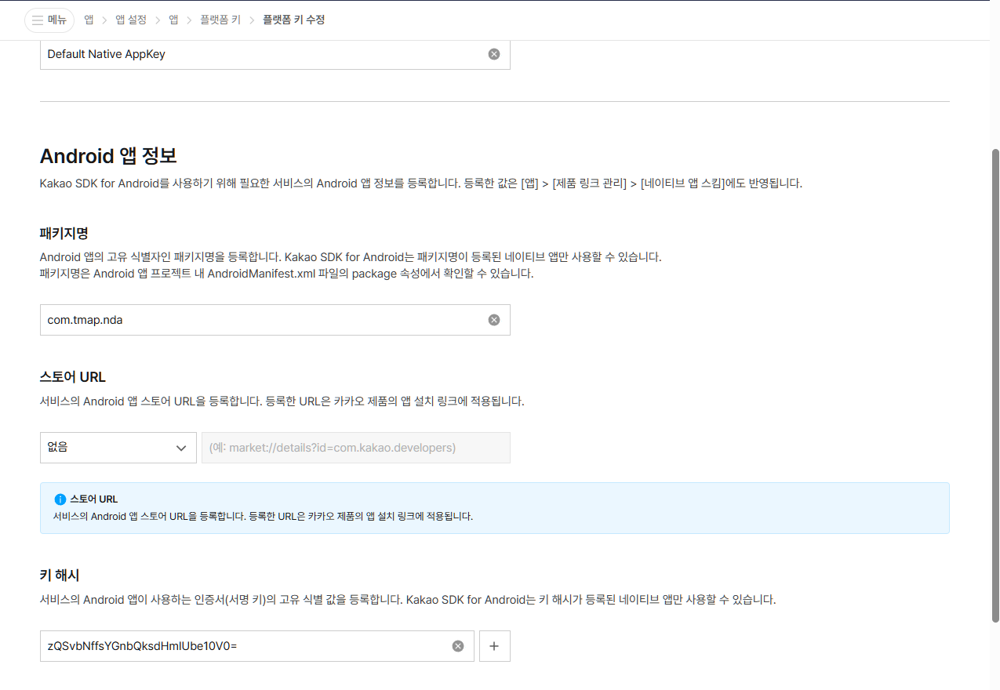</p>

**② 카카오맵 사용 설정** — 좌측 **제품 설정 → 카카오맵** → **사용 설정**을 **ON**으로 켜고 저장

<p align="center">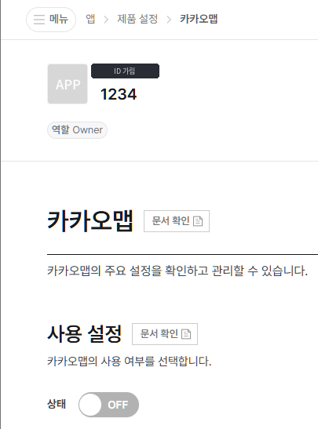</p>

**3.** **Default Native AppKey** 를 복사합니다. (REST API 키는 쓰지 않으니 복사하지 않아도 됩니다)

**4.** TmapNda에서 **≡ 메뉴 → 설정 → 길안내 선택 → 카카오로 길 안내**를 누르고 키를 붙여넣은 뒤 **저장하고 재시작**을 누릅니다.

> ⚠️ 반드시 **네이티브 앱 키**를 넣으세요. JavaScript 키나 REST API 키를 넣으면 카카오 서버가 거부해서(`INVALID_TOKEN`) 카카오 길안내가 켜지지 않습니다.

### 3. 네이버 키 (네이버 길안내용)

카카오로 길안내하는 분은 건너뛰세요. 무료 사용량은 **대표(메인) 계정**에만 적용됩니다. 월 3,000건 안쪽이면 무료이고, 앱은 한 달 2,800건에서 호출을 막아 무료 한도를 지켜 줍니다.

**1.** [www.ncloud.com](https://www.ncloud.com) 가입 후 **메인 계정**으로 로그인

<p align="center">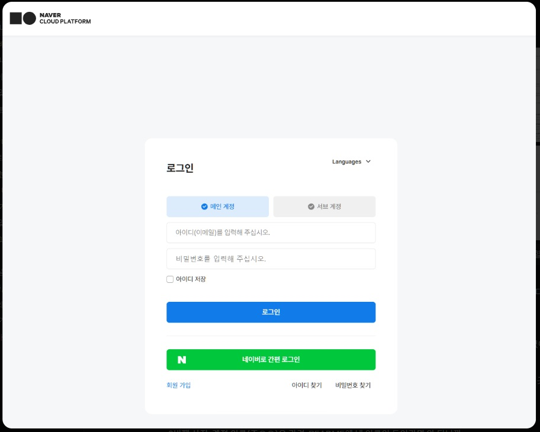</p>

**2.** **결제 수단(카드) 등록** — 우측 상단 내 계정 → **과금 정보 및 비용 관리**. 무료 사용량 안에서는 요금이 나오지 않지만, Maps를 쓰려면 먼저 등록돼 있어야 합니다.

<p align="center">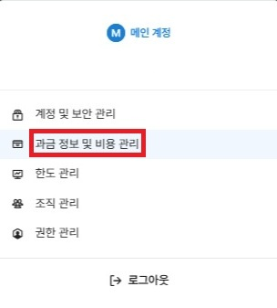</p>
<p align="center">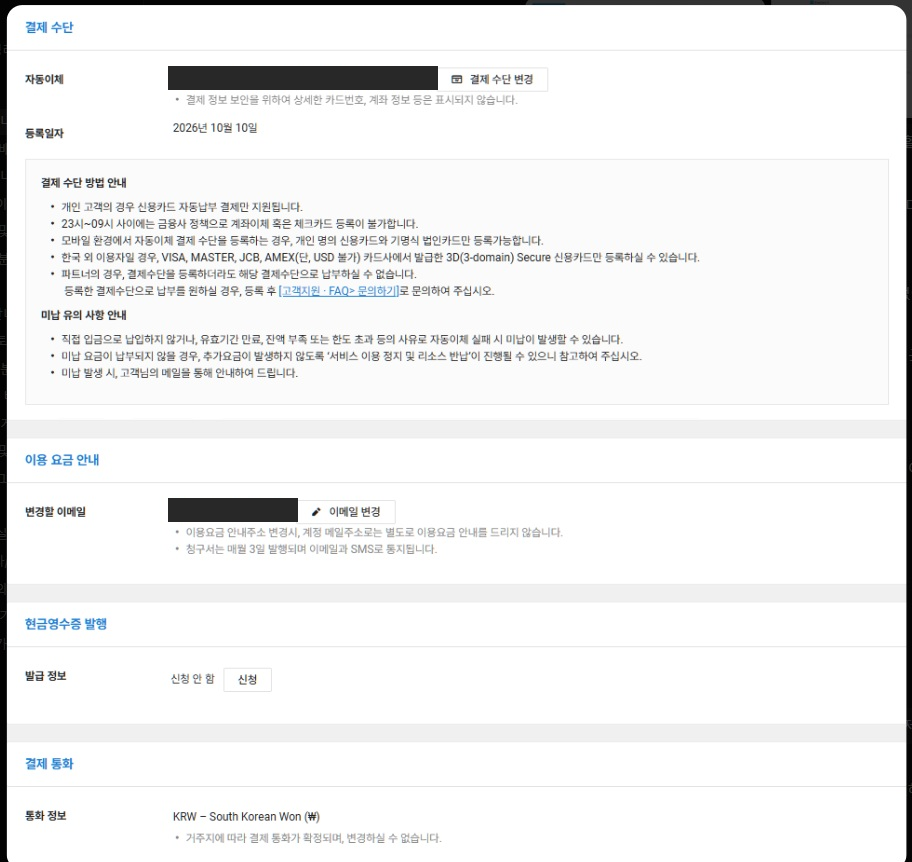</p>

**3.** 상단 검색창에 **Maps** → **Services → Maps** → **이용 신청**

<p align="center">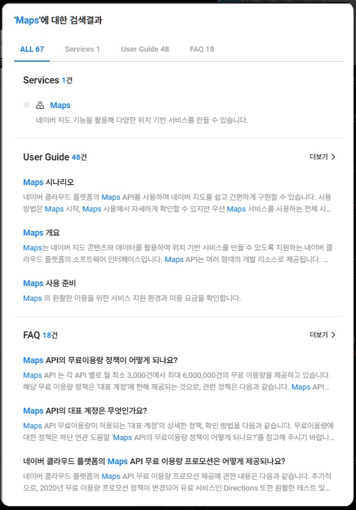</p>

**4.** **+ Application 등록**을 눌러 입력합니다.

| 항목 | 값 |
|---|---|
| Application 이름 | 자유 입력 (예: TmapNda) |
| API 선택 | **Dynamic Map**, **Directions 5** 체크 |
| Android 앱 패키지 이름 | `com.tmap.nda` 입력 후 **오른쪽 "+ 추가" 버튼을 꼭 누르기** (목록에 들어가야 등록 완료) |

<p align="center">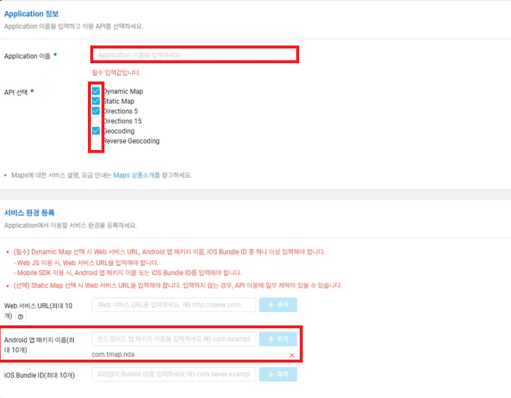</p>

> Dynamic Map을 빼먹으면 지도에 **429** 오류가, 패키지 이름이 다르면 **401** 오류가 나서 지도가 안 뜹니다.

**5.** 등록한 Application의 **인증 정보** 버튼을 눌러 **Client ID(= Key ID)** 와 **Client Secret(= Key Secret)** 을 복사합니다. 같은 창 아래쪽 **Android 앱 패키지 이름이 `com.tmap.nda`** 인지도 꼭 확인하세요. 길안내가 "계산 실패"로 나오면 대부분 이 값이 틀린 경우입니다. 키는 남에게 보여 주지 마세요.

<p align="center">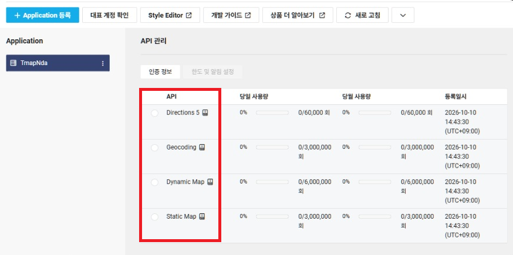</p>
<p align="center">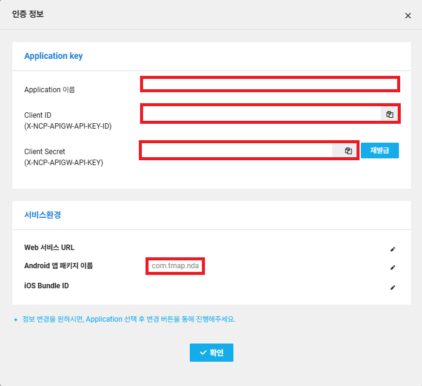</p>

**6.** TmapNda에서 **≡ 메뉴 → 설정 → 길안내 선택 → 네이버로 길 안내** → Key ID와 Key Secret 붙여넣기 → **저장하고 재시작**

> 같은 창 아래 **카카오 네이티브 앱 키 (선택)** 칸에 카카오 키를 함께 넣어 두면, 네이버 길안내 중에도 먼 곳의 카메라·방지턱·구간단속이 지도에 미리 표시됩니다. 비워 두면 이 표시만 빠집니다.
>
> 카카오로 되돌리려면 같은 곳에서 **카카오로 길 안내**를 누르면 됩니다.

### 4. 오피넷 키 (선택)

주유소를 **브랜드별·최저가순**으로 보고 싶을 때 필요합니다. **각자 발급받아 각자 넣어야 합니다** (여럿이 한 키를 쓰면 하루 1,500건 한도가 금방 찹니다). 안 넣어도 앱은 정상이고, 주유소는 일반 검색 결과로 나옵니다.

**1.** [opinet.co.kr](https://www.opinet.co.kr) → 우측 상단 **회원가입** → 약관 동의 → 휴대폰 인증

<p align="center">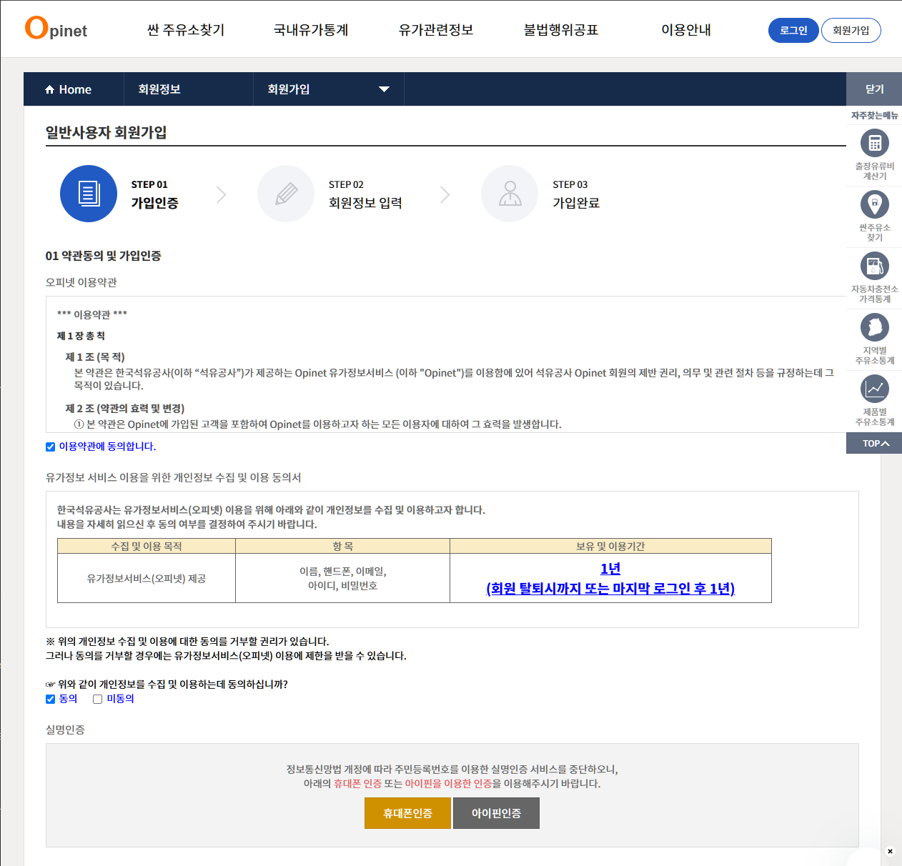</p>
<p align="center">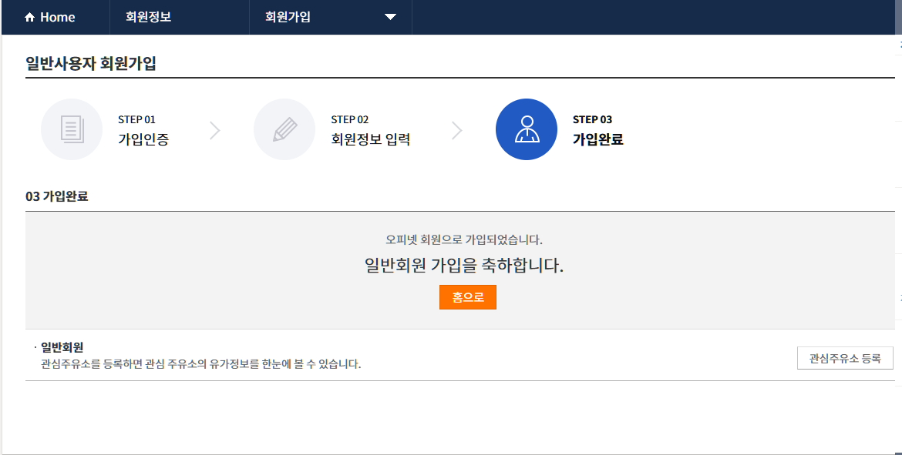</p>

**2.** 로그인 → **유가관련정보 → 유가정보 API → 무료 API 이용 신청** → 승인되면 마이페이지에서 인증키 확인

<p align="center">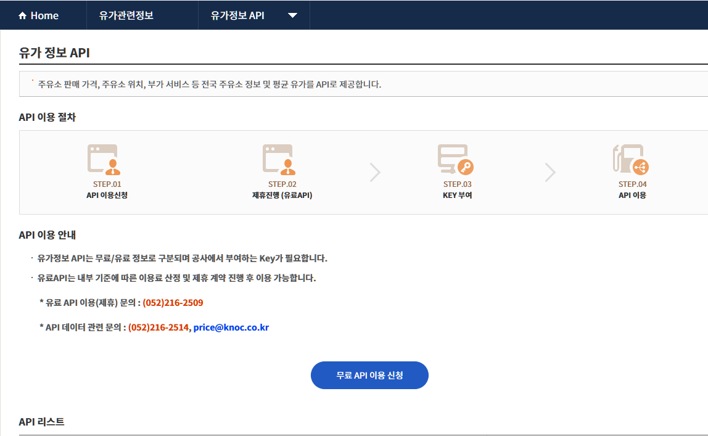</p>

**3.** TmapNda 첫 화면의 **오피넷 API 키** 칸에 붙여넣고 저장 (이미 실행했다면 **≡ 메뉴 → 설정을 길게 누르기**)

### 5. 전기차 충전소 키 (선택)

충전기 **대기/충전중/고장** 같은 실시간 상태를 보고 싶을 때 필요합니다. 안 넣어도 충전소 위치 검색은 됩니다. 이것도 각자 발급합니다.

**1.** [data.go.kr](https://www.data.go.kr) → **회원가입 → 일반회원(만 14세 이상 내국인)** → 약관 동의 → 정보 입력 → 본인인증

<p align="center">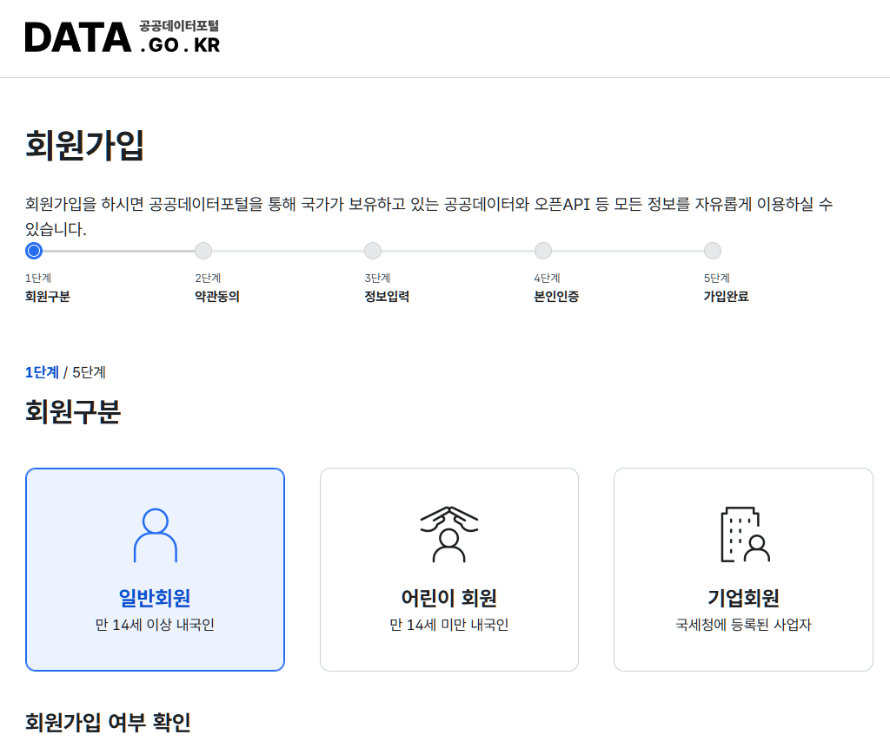</p>
<p align="center">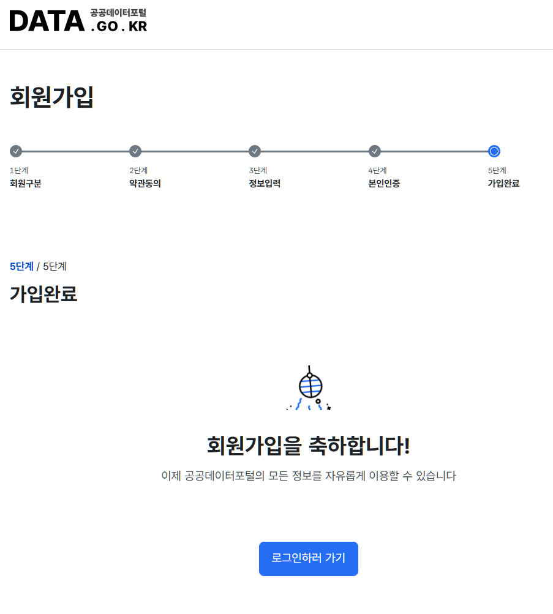</p>

**2.** 로그인 → 검색창에 **"한국환경공단 전기자동차 충전소 정보"** 검색 → 결과에서 **오픈API "한국환경공단_전기자동차 충전소 정보"** 선택

<p align="center">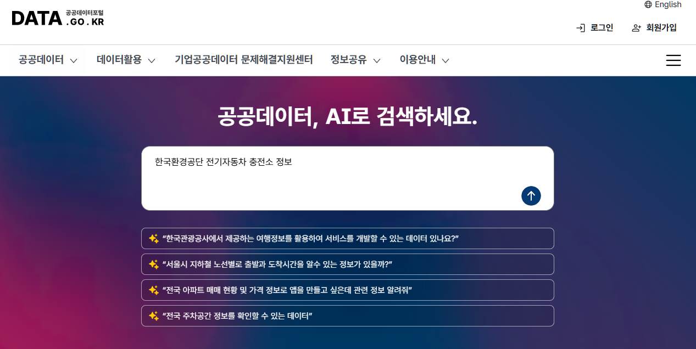</p>
<p align="center">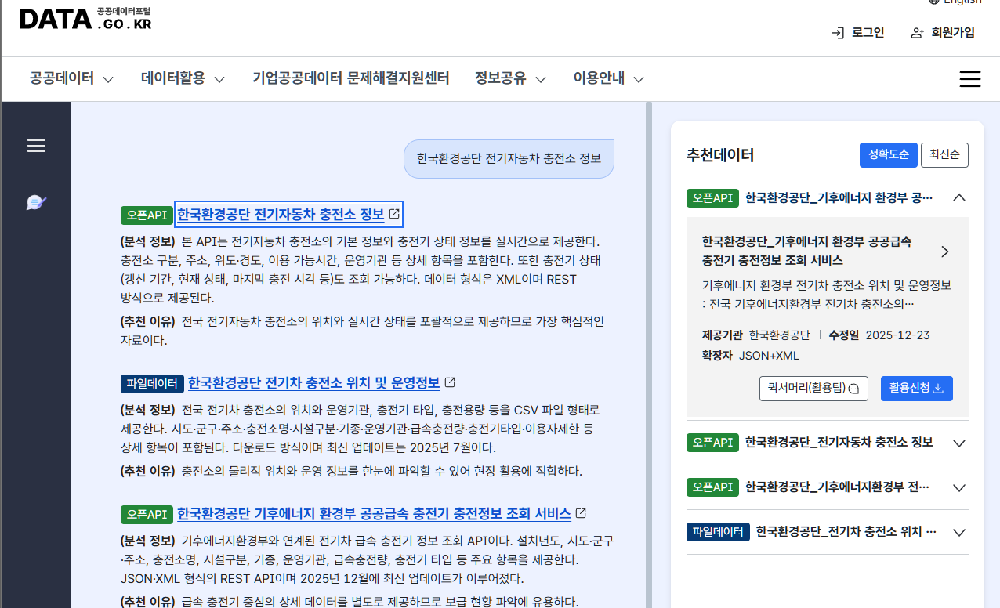</p>

**3.** 상세 페이지에서 **활용신청** → 활용 목적을 간단히 적고, 하단 라이선스 **동의합니다** 체크 → **활용신청** (자동승인이라 바로 승인됩니다)

<p align="center">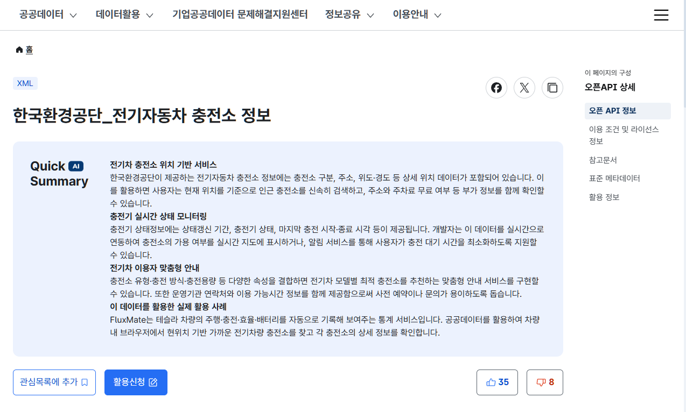</p>
<p align="center">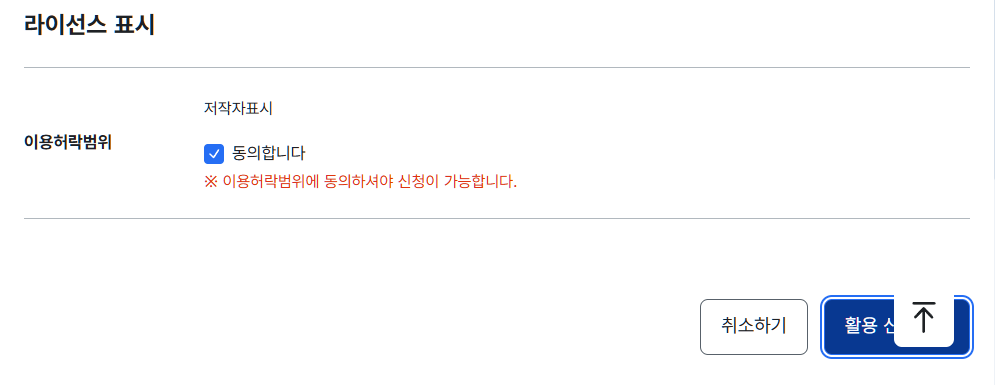</p>

**4.** 마이페이지 → 활용신청 현황 → 상세 → **일반 인증키(Encoding)** 복사

<p align="center">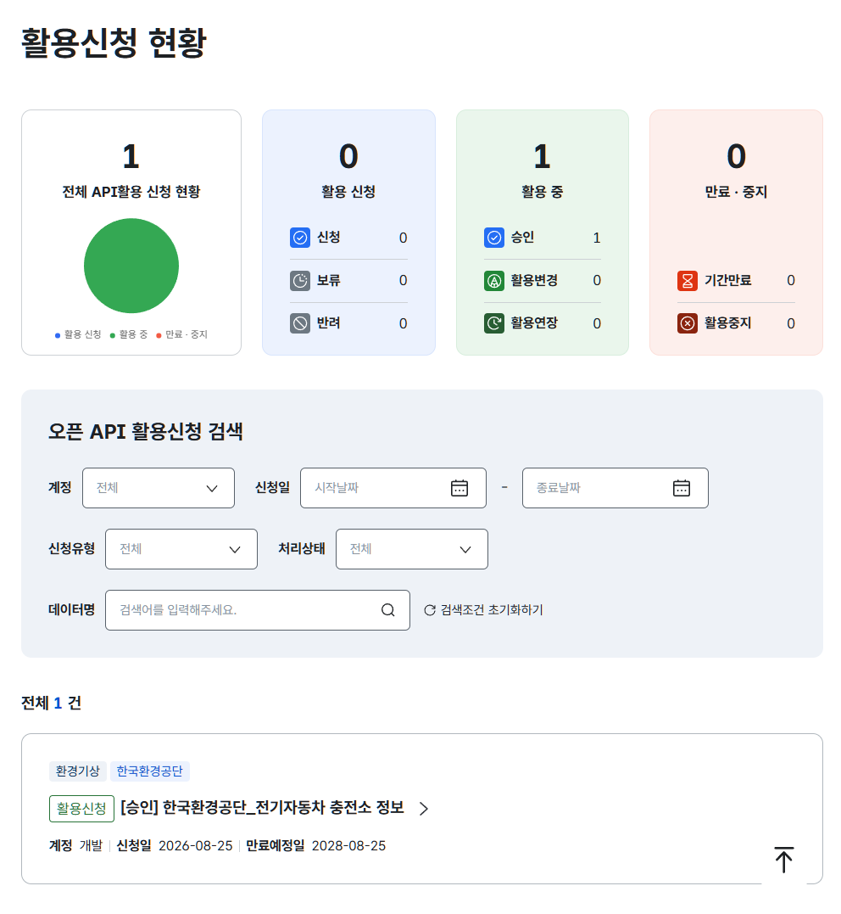</p>

**5.** TmapNda 첫 화면의 **전기차 충전소 API 키** 칸에 붙여넣고 저장

---

## 처음 실행하고 연결 확인하기

### 첫 화면(안전운행 시작하기)에서 할 일

| 칸 | 할 일 |
|---|---|
| 앱키 | 티맵 키 붙여넣기 (필수) |
| 오피넷 / 전기차 충전소 키 | 있으면 붙여넣기 (없으면 비워 두세요) |
| **내 닉네임** | ⚠️ **디스코드 서버 닉네임과 똑같이** 적어 주세요. 문제가 생겼을 때 개발자가 내 기기를 찾으려면 이 값이 꼭 필요합니다. |
| 다른 앱 위에 표시 | 체크하면 다른 앱을 쓰는 중에도 다음 회전 카드가 화면 위에 떠 있습니다 ([자세히](#그-밖의-기능)). 체크하면 권한 화면으로 이동하니 거기서 TmapNda를 허용해야 실제로 동작합니다. |
| 백업 파일로 복원 | 앱을 새로 설치했다면 여기서 예전 설정을 되살릴 수 있습니다 |

앱을 처음 열면 **배터리 최적화 예외** 팝업이 뜹니다. **"허용"** 을 권장합니다. 안 하면 화면이 꺼진 사이 시스템이 통신을 조여서 콤마와의 연결이 조용히 끊길 수 있습니다. (허용하면 다시 안 뜹니다)

### 콤마와 연결되었는지 확인

- 폰과 콤마는 **같은 네트워크(같은 와이파이)** 에 있어야 합니다.
- 폰에 저장된 와이파이가 여러 개면 신호가 센 다른 곳으로 자동 전환되어 콤마와 갈라지는 일이 잦습니다. **콤마와 쓸 와이파이 하나만 남기고 나머지는 "삭제(잊기)"** 하는 걸 권장합니다.
- 정상이면 상단바에 아래처럼 보입니다.

| 표시 | 뜻 |
|---|---|
| `Comma 연결됨` | 폰과 콤마가 네트워크로 연결됨 |
| `크루즈 작동중` / `크루즈 대기중` | openpilot이 실제로 조향·가속을 하는 중인지 여부. 연결은 됐지만 크루즈를 아직 안 켠 `대기중`은 **정상**입니다 |
| `크루즈 불안정` | openpilot 상태가 아주 짧게 여러 번 바뀔 때, 깜빡임 대신 보여 주는 표시 |

연결이 안 되면 [문제 해결 표](#문제-해결-표)로 가세요.

---

## 설정 켜고 끄는 법

**≡ 메뉴 → 설정**을 누르면 왼쪽에 항목 목록, 오른쪽에 그 항목의 스위치가 나옵니다.

- 스위치는 **켬 = 초록, 끔 = 회색**입니다.
- **누르는 즉시 저장되고 바로 적용됩니다.** 저장 버튼은 없고, 다 했으면 "닫기"로 나가면 됩니다.
- 설정 창은 끌어서 옮길 수 있고, 카드 바깥을 누르면 닫힙니다.
- 설정 글자를 **길게 누르면** 첫 화면의 키 입력 화면으로 돌아갑니다.

### 설정 항목 한눈에 보기

| 설정 그룹 | 들어 있는 것 (기본값) |
|---|---|
| **길안내 선택** | 카카오로 길 안내 / 네이버로 길 안내 (고르면 키 입력 → **저장하고 재시작**). "옵션을 길안내 메뉴(☰)에 묶기" (켜짐) |
| **티맵 설정** | 티맵 화면 전용 옵션 (설정 창에서 직접 확인하세요) |
| **안전운전** | 이동식카메라 감속, 속도 10% 초과 경고음, 목적지 근처 도착 알림, 사고·공사 알림, 긴급차량 접근 알림, 사고 다발 구간 알림, 스쿨존 회피(카카오 전용), 최소 안내, 돌발정보 가운데 경고, 돌발정보 차량에도 보내기, 앱이 뒤에 있어도 사고 팝업(꺼짐) |
| **화면 표시** | 티맵 위성지도, 티맵 교통 정보, 티맵 터치 잠금 해제(지도 터치 잠금 해제), 지도 밝기(자동/항상 낮/항상 밤), 경로선 콤마 화면에 표시(꺼짐), 1000m 이상은 km로 표시, 미니 플레이어 표시(켜짐), 상단바 표시/숨김 플로팅 버튼(꺼짐), 차량 연결시 폰 화면 블랙 처리(꺼짐) |
| **버튼 표시** | 즐겨찾기·경유지·카테고리·경유지 취소 버튼 표시, 메뉴버튼 분리(꺼짐), 아이콘 위치 잠금(꺼짐), 팝업 위치 잠금(꺼짐) |
| **음성** | 음성 보정 (틀린말=원래말 한 줄에 하나씩) |
| **기타** | 즐겨찾기 표시 개수(0~10), 즐겨찾기 폴더 사용, 길안내 음량 안내, 안내 목소리(네이버), 차종·연료·하이패스, 카카오 지도 미리 받기, 오프라인 길찾기·검색 자료 받기, 설정 백업/복원 |
| **자율주행** (시험) | 자동 길안내 주행(꺼짐), 깜빡이 켜기 허용(꺼짐) — 책임은 본인에게 있습니다. [자세히](#그-밖의-기능) |

> "옵션을 길안내 메뉴(☰)에 묶기"가 **켜져 있으면** 카카오·네이버 전용 옵션은 길안내 화면 아래 바의 **☰ 메뉴**에서 바꿉니다. **끄면** 설정 창에 "카카오 설정"/"네이버 설정" 탭이 나옵니다.

### 이럴 땐 이 스위치

| 하고 싶은 것 | 방법 |
|---|---|
| 카카오 ↔ 네이버 바꾸기 | 설정 → 길안내 선택 → 원하는 쪽 누르기 → 키 입력 → 저장하고 재시작. 안내 중에 바꿔도 앱이 다시 켜진 뒤 같은 목적지로 이어서 안내합니다 |
| 경고음이 시끄러움 | 설정 → 안전운전 → "속도 10% 초과 시 경고음" 끄기 |
| 안내 멘트가 너무 많음 | 설정 → 안전운전 → **최소 안내** 켜기 (시내 2번, 고속도로 3번만 말함) |
| 상단바를 지도에서 치우기 | 설정 → 화면 표시 → "상단바 표시/숨김 플로팅 버튼 보이기" 켜고 동그란 버튼 누르기 |
| 아이콘이 자꾸 움직임 | 설정 → 버튼 표시 → "아이콘 위치 잠금" 켜기 |
| 팝업이 자꾸 움직임 | 설정 → 버튼 표시 → "팝업 위치 잠금" 켜기 |
| 차 연결할 때 폰 화면 까맣게 | 설정 → 화면 표시 → "차량 연결시 폰 화면 블랙 처리" 켜기 ([자세히](#화면-구성)) |
| 폰을 바꾸거나 앱 데이터가 날아갈 때 대비 | 설정 → 기타 → **백업(공유)** 또는 **백업(로컬)** |
| 백업에서 되살리기 | 설정 → 기타 → **복원** → 파일 선택 → 앱 재시작. 새로 설치한 직후라면 첫 화면의 "백업 파일로 복원" 버튼 |

**백업 자세히:** 즐겨찾기(폴더 포함)·API 키·화면 설정이 파일 하나로 저장됩니다. "백업(공유)"는 구글 드라이브·이메일 등 원하는 곳에 저장하고, "백업(로컬)"은 다운로드 폴더에 `TmapNda_BackUp.json`으로 바로 저장합니다(다시 눌러도 덮어씀). 버튼을 안 눌러도 **하루에 한 번 자동으로** 기기 안에 조용히 백업됩니다.

**차종·연료:** 한 번 골라 두면 길안내 경로 계산과 주유소 안내에 계속 적용됩니다. 차종은 승용차·이륜차·화물 2~6종, 연료는 휘발유·고급휘발유·경유·LPG·전기·하이브리드·플러그인하이브리드·수소, 하이패스 장착 여부(켜면 통행료를 하이패스 요금으로 계산). 기본은 승용차·휘발유·하이패스 꺼짐. 네이버는 차종만 통행료 등급에 반영합니다.

---

## 화면 구성


**상단바** (티맵·카카오·네이버 화면 공통)

속도 · 도로 제한속도 · Comma 연결 상태 · 크루즈 상태 · GPS 정확도 · 음소거 · 음성 검색(마이크) · 목적지 검색(+최근검색) · 집·회사 · ≡ 메뉴 · (길안내 중엔 안내종료) · 이벤트 아이콘(과속카메라·구간단속·방지턱·어린이보호구역·톨게이트 등 24종, 해당될 때만 표시)

- **상태 눌러서 새로고침**: GPS 상태 창을 톡 누르면 위치 수신을 다시 시작하고, Comma 연결 상태를 톡 누르면 콤마와 다시 연결을 시도합니다.
- **화면이 좁을 때**: 덜 중요한 칸부터 자동으로 숨습니다 (검색창 → 검색 버튼 → 음소거 → 연결상태 → GPS 순). 그래도 모자라면 좌우로 스크롤됩니다.
- **≡ 메뉴**: 업데이트 · 업데이트 내역 · 내 차 위치 · 설정 · 도움말 · 로그 삭제 · 앱 종료. 메뉴 바깥을 누르면 닫힙니다.

**위치 옮기기**

| 대상 | 방법 |
|---|---|
| 상단바 | 속도 숫자나 GPS 상태 창을 **1초쯤 꾹 누른 채 끌기** (살짝 진동이 옴). 손을 떼면 가까운 위/아래 가장자리에 붙고 저장됨. 짧게 톡 누르면 원래 기능 실행 |
| 즐겨찾기·주변·경유지·경유지 취소 아이콘 | 꾹 안 눌러도 **살짝 끌면 바로** 이동 (가로/세로 화면별로 따로 저장). 다른 아이콘 근처에 가면 자석처럼 줄이 맞음 |
| 상단바 표시/숨김 버튼, 미니 플레이어 | **1초 꾹 누르면** 그 자리에서 이동 |
| 팝업 카드 | 카드의 빈 배경을 잡고 끌기 (손을 떼면 위치 저장) |
| 메뉴 아이콘 | 설정 → 버튼 표시 → "메뉴버튼 분리"를 켜면 다른 아이콘처럼 옮길 수 있음 |

**길안내 화면 공통 기능**

- **지도 확대·축소**: 두 손가락으로 벌리거나 오므립니다. 손을 뗀 뒤 약 10초는 배율이 유지되고, 이후 원래 배율로 돌아옵니다.
- **운전자 쪽 지도 중심**: 가로 화면 길안내 중에는 내 차 위치가 가운데보다 운전석 쪽(왼쪽)으로 치우치도록 지도 중심이 맞춰집니다. 분할화면·세로 화면에서는 적용되지 않습니다.
- **터널·지하차도**: GPS가 3초 넘게 끊기면 콤마의 차 속도(콤마가 없으면 끊기기 직전 속도)로 경로를 따라간다고 보고 안내를 이어갑니다. GPS가 돌아오면 바로 실제 위치로 맞춥니다 (최대 15분).
- **길안내 중 티맵 음성**: 카카오·네이버 길안내가 시작되면 티맵 음성이 자동으로 꺼지고, 안내가 끝나면 원래대로 돌아옵니다.
- **볼륨 버튼**: 화면에 따라 역할이 다릅니다.

  | 화면 | 볼륨 버튼이 조절하는 것 |
  |---|---|
  | 카카오·네이버 길안내 화면 | **길안내 음성 크기** (톡 = 5%, 꾹 = 2%씩). 화면 아래 가운데에 값이 잠깐 표시됨 |
  | 티맵 화면 | **음악(미디어) 크기** (안드로이드 기본 동작) |

  길안내 음량과 음악 음량은 완전히 분리되어 있어서, 앱은 음악 볼륨을 건드리지 않습니다.
- **카카오·네이버 동시 동작 안 함**: 한쪽이 시작되면 다른 쪽의 음성·경고음·화면은 멈춥니다. 티맵 기능은 어느 쪽이든 그대로 동작합니다.

**카카오 길안내 ☰ 메뉴**: 아래 바의 ☰를 누르면 스쿨존 회피 · 최소 안내 · 경로선 콤마 표시 · 하이패스 장착 스위치가 먼저 뜨고, "카카오 메뉴 열기"를 누르면 카카오 원래 메뉴(음량, 전체경로, 다른경로, 경로취소, 안내종료)가 열립니다.

**네이버 길안내 화면과 ☰ 메뉴**

- 파란 회전 안내 카드(다음 회전 + 다음-다음 회전 한 줄), 도착지의 빨간 "도착" 표시, 경로선 위 진행 방향 화살표, 오른쪽의 정체 막대(초록·주황·빨강), 아래 도착 정보 바(도착 시각·남은 시간·남은 거리, ⟳ 경로 새로고침, ☰ 메뉴)가 나옵니다.
- 지도를 손으로 움직이면 왼쪽 아래에 "내 위치로 돌아오기"가 뜹니다. 회전 지점이 200m 안으로 오면 지도가 평면으로 확대됩니다.
- ☰ 메뉴: 안내음성 크기 · 다른 경로 · 지도설정(일반/위성, 교통정보, 평면 보기, 야간모드) · 주행설정(실시간 교통에 따른 경로 변경, 최소 안내, 주행선에 교통정보 표시, 지도 위 회전 표지 표시, 경로선 콤마 표시, 안내 목소리 선택) · 상세설정 · 안내 종료.
- 네이버는 직접 만든 안내 엔진이라 **차선 안내·신호등 잔여시간·고속도로 시설 목록이 없고**, 이동방식은 추천·고속도로·무료도로·큰길 우선 4가지만 나옵니다 (최단거리·선호경로는 카카오 전용).
- 길안내가 시작되면 화면 아래에 사용량이 5초간 표시됩니다. 네이버는 "이번 달 2800건 중 N%", 카카오는 "오늘 100,000건 중 N%"입니다. 카카오 숫자는 앱이 요청한 횟수라 카카오 서버 집계와 다를 수 있으니, 정확한 값은 카카오 개발자 콘솔의 통계 > 쿼터에서 확인하세요.
- **음성**: 네이버 안내는 폰에 설치된 한국어 음성(TTS)으로 말합니다. 설정 → 기타 → **안내 목소리 → 선택**에서 목록의 목소리를 하나씩 눌러 들어 본 뒤 "이 목소리로 저장"하면 됩니다. 고르지 않으면 `ko-kr-x-ism-network`(인터넷 필요)를 쓰고, 폰에 없으면 폰 기본 목소리로 말합니다. 인터넷이 약한 곳에선 "오프라인"으로 표시된 목소리가 안전합니다.

**차량 연결시 폰 화면 블랙 처리** (기본 꺼짐): USB로 차량(안드로이드 오토)에 연결되면 폰 화면을 새까맣게 만듭니다. 루팅된 기기는 화면 색만 조절해서 폰 화면만 어두워지고, 루팅이 없는 기기는 검은 창을 덮는 방식이라 폰 화면을 통째로 가져가는 연결에서는 차량 화면도 같이 어두워질 수 있습니다. 켜져 있는 동안 알림이 떠 있고, 알림을 탭하면 바로 해제됩니다. 차량 연결이 끊기면 자동으로 원래대로 돌아옵니다.

**좁은 창(분할화면)에서**: 최근 목적지 팝업이 창 크기에 맞춰 줄어들고, 저장·경로추가·삭제 버튼이 이름 아래 줄로 내려갑니다.

---

## 목적지 찾고 출발하기

### 검색

- 검색창에 입력하면 티맵 장소 검색 결과가 **최대 60건**, 10개씩 페이지로 나옵니다 ("이전 / 다음 / 취소").
- 정렬: ① 검색어와 이름이 완전히 같은 곳 → ② 검색어로 시작하는 곳 → ③ 글자가 순서대로 들어 있는 곳 → ④ 그 외. 각 묶음 안에서는 **가까운 순**입니다.
- 스타벅스·맥도날드 같은 **드라이브스루(DT) 매장은 같은 묶음 안에서 위쪽**에 뜹니다.
- "편의점·주유소·약국·병원·카페·은행·마트·주차장"처럼 종류로 검색하면 가까운 순 전용 검색으로 자동 전환됩니다.
- 결과마다 현재 위치 기준 거리와 예상 소요시간이 표시됩니다.
- 검색창을 눌러 타이핑하면 키보드만 뜨고, **"최근검색" 아이콘**을 눌러야 최근 목적지 팝업이 뜹니다.

### 지도를 눌러 출발

지도의 아무 곳이나 누르면 그 자리를 목적지로 삼을지 묻습니다. (첫 화면 티맵 지도는 설정의 **"지도 터치 잠금 해제"** 를 켜야 눌립니다)

| 상황 | 나오는 버튼 |
|---|---|
| 길안내 중이 아닐 때 | 저장 / 길 안내 (카카오·네이버 화면은 취소 / 저장 / 길 안내). 가까운 건물 이름과 주소가 함께 나옵니다 |
| 길안내 중 | 경유지 추가 / 새 목적지 / 저장 |
| 길안내 중 + 경유지가 이미 있음 | 경유지 추가 / 경유지 삭제 / 새 목적지 |

"저장"을 누르면 이름을 고치고 즐겨찾기 폴더를 골라 바로 저장됩니다. 취소는 팝업 바깥을 누르면 됩니다.

### 이동방식 고르기 (지도 미리보기)

목적지를 고르면 길안내 지도로 먼저 넘어가서 핀이 찍힌 위치와 경로를 보여 주고, 아래 카드에서 이동방식을 고릅니다. 각 방식의 **예상 시간·통행료**가 같이 표시됩니다.

| 이동방식 | 설명 |
|---|---|
| 추천 경로 | 시간·거리·교통·요금을 종합해 고른 기본 경로 |
| 고속도로 | 고속도로·자동차전용도로를 최대한 타는 경로 |
| 무료도로 | 통행료가 나오는 길을 피하는 경로 |
| 큰길 우선 | 넓고 큰 도로 위주 |
| 최단거리 | 거리가 가장 짧은 경로 (카카오 전용) |
| 선호경로 | 카카오의 선호 경로 옵션 (카카오 전용, 다른 경로와 같게 나올 수 있음) |

- **자동 출발**: "안내 시작" 버튼에 10초 카운트다운이 돌고, 아무것도 안 누르면 자동으로 출발합니다. **이동방식 칸을 하나라도 누르면 자동 출발이 멈추고** "안내 시작"을 직접 눌러야 합니다.
- **칸 순서 바꾸기**: 칸을 0.5초 꾹 누르면 떠오르고, 다른 칸 위에 놓으면 자리가 바뀝니다. 저장되며 첫 번째 칸이 처음 선택되는 방식입니다.
- 계산이 오래 걸리면 "계산 중..."으로 보이다가 채워지고, 25초가 지나도 결과가 없으면 "계산 실패"로 바뀝니다.
- 추천 경로와 시간·거리가 똑같은 칸은 **흐리게** 보이고, 누르면 "추천 경로와 같음"이 나옵니다.
- "취소"를 누르면 티맵 화면으로 돌아갑니다.

### 안내 이어가기

길안내 중 앱을 업데이트하거나 강제 종료했다가 다시 켜면 "OO(으)로 가던 중이었어요. 이어서 안내할까요?"라고 묻습니다.

- **이어서 안내**: 같은 목적지로 바로 재개 (경유지가 있었다면 "경유지 N곳 포함"으로 표시되고, 이미 지난 경유지는 빠짐)
- **아니요**: 무시하고 새로 검색
- 목적지에 도착하거나 "안내종료"로 직접 끈 경우는 저장 정보가 지워져 묻지 않습니다. 앱이 갑자기 죽었을 때만 남습니다.

### 경유지

안내 중에 주변 검색·지도 터치·음성 명령으로 경유지를 추가할 수 있습니다. 추가하면 길안내 화면에 빨간 **"경유지 취소"** 버튼이 나타나고, 누르면 확인 후 경유지 없이 원래 목적지로 다시 안내합니다.

---

## 즐겨찾기·집·회사

상단바에 **집·회사** 아이콘과 ❤️ **즐겨찾기** 아이콘이 있습니다.

| 상태 | 짧게 누르기 | 길게 누르기 |
|---|---|---|
| 등록 안 됨 | 검색해서 고르면 그 자리에 등록 | 위와 같음 |
| 등록됨 | 이동방식이 저장돼 있으면 **바로 안내 시작**, 없으면 "추천/고속도로/무료도로" 확인 | "다시 검색 / 이름 변경 / 이동방식 저장 / 삭제 / 홈화면에 추가 / 취소" |

- 등록하면 하트 대신 **장소 이름**과 현재 위치 기준 예상 소요시간("OO분")이 표시됩니다 (즐겨찾기 카드를 열 때마다 새로 계산. 네이버는 직선거리 기반 추정값).
- **이동방식 저장**을 해 두면 다음부터 팝업 없이 바로 출발합니다.
- **이름 변경**은 저장된 주소는 두고 화면 표시 이름만 바꿉니다. **삭제**하면 빈 칸으로 돌아갑니다.
- 표시 개수는 설정 → 기타 → "즐겨찾기 표시 개수"(0~10)에서 바꿉니다.
- 즐겨찾기 카드 안의 칸을 **길게 누른 채 끌어서** 순서를 바꿀 수 있습니다 (바로 저장).
- 빈 칸을 눌러 나오는 검색창에는 "음성으로 검색" 버튼이 있어 말로도 등록됩니다.
- 집·회사 아이콘은 고정이라 따로 옮길 수 없습니다 (상단바 전체를 옮길 수는 있음).

### 즐겨찾기 폴더

설정 → 기타 → **"즐겨찾기 폴더 사용"** 을 켜면 ❤️를 누를 때 폴더 목록이 먼저 나옵니다.

- **＋ 새 폴더**로 폴더를 만들고 이름도 직접 짓습니다. 폴더 수와 폴더 안 장소 수에는 제한이 없습니다.
- 폴더를 누르면 안의 장소가 위 표와 같은 방식으로 동작합니다 (＋ 장소 추가, 끌어서 순서 바꾸기).
- 폴더를 길게 누르면 이름 바꾸기·삭제가 나옵니다. **삭제하면 안의 장소도 함께 지워집니다.**
- 기존 즐겨찾기는 "기본" 폴더로 자동으로 들어갑니다.
- 끄면 "표시 개수" 방식으로 돌아가고, 저장한 폴더·장소는 그대로 보관됩니다.

### 홈화면 바로가기

즐겨찾기를 길게 눌러 **"홈화면에 추가"** 를 고르면 안드로이드 홈화면에 전용 아이콘이 생깁니다 (집=파랑, 회사=주황, 즐겨찾기=빨간 하트). 누르면 앱이 열리며 안내가 시작되고(다른 곳으로 안내 중이면 먼저 묻습니다), 이동방식이 저장돼 있으면 그 방식으로 바로 출발합니다.

### 내 차 위치

콤마 연결이 끊기면(시동을 끈 것으로 보고) 마지막 위치를 자동 저장합니다. 터널 등으로 잠깐 끊겼다가 5분 안에 다시 연결되면 오탐으로 보고 폐기합니다. **≡ 메뉴 → 내 차 위치**를 누르면 지도에 차 위치(주황색 "차")와 내 위치(파란 점), 저장된 시각이 나옵니다. GPS 버튼을 한 번 누르면 내 위치로 이동·확대, 한 번 더 누르면 내 위치를 따라갑니다. 카카오 길안내 중에는 쓸 수 없습니다.

---

## 주변 검색 (주유소·충전소 등)

**카테고리 버튼**을 누르면 왼쪽에 카테고리(편의점·주유소·전기차 충전·주차장 등), 오른쪽에 근처 결과가 10개씩 뜹니다 (페이지는 오른쪽 위 번호로 넘김). 결과에는 이름·거리·예상 소요시간, 그리고 지금 가는 방향과 **같은 방향("진행방향")인지 반대("역방향")인지**가 표시됩니다. 카카오 길안내 중이면 실제 경로선 기준이라 "직선으론 앞인데 돌아가야 하는 곳"은 뒤로 밀립니다.

- **주유소**: 오피넷 키가 있으면 처음 한 번 유종(휘발유/경유/LPG)을 고르고, 브랜드는 여러 개를 체크해서 저장합니다 (결과 화면 위 "브랜드 필터 변경"으로 언제든 바꿈). **가격 70% + 거리 30%** 로 싸고 가까운 곳이 위로 옵니다. 키가 없으면 일반 검색 결과가 나옵니다.
- **전기차 충전소**: 위치는 티맵 검색으로 정확히 가져오고, 환경공단 키가 있으면 150m 이내 충전기 상태를 붙입니다 (예: "충전기 4대 (급속 2·완속 2) · 대기 2 · 충전중 1"). 속도 필터(전체/초급속/급속/완속)도 있습니다. 매칭이 안 되면 "충전기 정보 없음"입니다.
- 나머지 카테고리는 티맵 장소 검색 기반입니다.
- **안내 중**: 결과를 고르면 "경유지로 추가 / 새 목적지로 변경 / 취소"를 묻습니다.
- 왼쪽 카테고리 목록은 **길게 누른 채 끌어서** 순서를 바꿀 수 있고 바로 저장됩니다.
- 이 버튼들은 설정 → 버튼 표시에서 각각 켜고 끌 수 있습니다.

---

## 안전 정보 (카메라·사고·공사)

### 카메라·구간단속·방지턱

과속카메라·구간단속·방지턱·스쿨존 같은 안전 정보는 **티맵에서 받아 콤마에 전달**합니다. 카카오로 길안내하든 네이버로 하든 같고, 상단바 이벤트 아이콘과 경고음도 이 정보를 따릅니다.

- **카카오 길안내**: 카카오가 음성으로 안내합니다. "최소 안내"를 켜면 시내 300m·100m, 고속도로 2km·1km·300m 앞에서만 말합니다.
- **네이버 길안내**: 네이버엔 안전정보가 없어서 앱이 직접 "전방 ○○미터 앞에 ○○이 있습니다"라고 말합니다 (한 항목당 최대 2번, 600m 안·200m 안). 이 음성은 **티맵 안내음성을 끈(무음) 상태에서만** 나옵니다. 켜져 있으면 티맵이 직접 말합니다.
- **경고음**: 제한속도의 **110%를 넘을 때만** 울립니다 (티맵·카카오·네이버 모두 화면에 보이는 제한속도 기준). 카카오·네이버 화면에서는 단속 카메라 300m 안에서 110% 이내로 줄이거나 카메라를 지날 때까지 울립니다. 설정 → 안전운전의 "속도 10% 초과 시 경고음"을 끄면 울리지 않습니다.
- **네이버 지도의 안전정보 표시**: 경로선 위 앞쪽 안전정보가 아이콘+남은 거리로 가까운 순 최대 4개 표시됩니다. 카카오 앱 키를 함께 넣어 두면 약 3km 앞까지 미리 보여 줍니다 (실험적 기능).

### 사고 다발 구간·긴급차량

경로 앞 3km 안에 사고 다발 지점이 있거나 긴급차량(구급차 등) 접근 정보가 있으면 화면에 자동으로 알려줍니다. 설정 → 안전운전에서 끌 수 있습니다 (기본 켜짐).

### 돌발정보 (사고·공사)

앞쪽 도로의 사고·공사·재난을 국가교통정보센터 자료로 알려줍니다. 카카오·네이버·티맵 모두에서 쓸 수 있습니다.

- **지도 표시**: 사고(빨간 동그라미 "!"), 공사(주황 네모 "공"), 기상(파란 동그라미 "비")이 카카오·네이버 지도에 표시됩니다. 네이버에서는 표시를 누르면 설명이 나옵니다. 티맵 화면은 지도 표시 없이 경고만 나옵니다.
- **앞쪽 경고**: 길안내 중에는 경로선 앞 3km 안(옆으로 50m 이내), 안내가 없을 땐 진행 방향 정면에 새 사고·재난이 잡히면 화면 가운데에 "410m 앞 사고발생!" 빨간 상자가 5초 뜨고 경고음이 울립니다. **공사는 경고음 없이** 주황 상자("공사중!")만 뜹니다.
- **계기판 빨강 번쩍임** (실험적): 새 사고·재난이 처음 잡히면 차 계기판 배경이 빨갛게 두 번 번쩍입니다. "돌발정보 차량에도 보내기"가 켜져 있고 콤마 쪽에 해당 코드가 있어야 하며 차종에 따라 안 보일 수 있습니다.
- **고속도로 정체** (실험적): 앞쪽 3km 안 같은 방향 정체를 "1.2km 앞 정체 시속 23 (3.3km)"처럼 알려줍니다 (경고음 없음, 고속국도 주요 24개 노선, 약 15분 간격 갱신).
- **가변 제한속도**: 안개·비·정체로 낮아진 제한속도가 앞 2km 안에 있으면 "800m 앞 제한 80 (기본 100)"처럼 알려줍니다.
- **앱이 뒤에 있어도 사고 팝업**: 설정 → 안전운전에서 켜면 다른 앱을 보는 중에도 팝업으로 알립니다. 켜 두는 동안 알림이 계속 떠 있고 배터리를 더 쓰며 "다른 앱 위에 표시" 허용이 필요합니다 (기본 꺼짐).
- **상단바로만 보기**: "돌발정보 가운데 경고"를 끄면 가운데 큰 경고 대신 상단바에 한 줄로 뜹니다.
- **차량에도 보내기** (실험적): 켜면 사고·정체를 콤마·차량 계기판에도 글자로 알립니다 (제한속도는 건드리지 않음).
- **끄는 법**: 카카오는 ☰ 메뉴, 네이버는 설정에서 **"돌발상황 표시"** 를 끄면 지도 표시와 경고가 모두 꺼집니다.
- 자료는 서버에서 2분마다 갱신됩니다. 인터넷이 없거나 서버에 문제가 있으면 돌발정보만 빠지고 길안내는 그대로 됩니다. 서버에는 이동 구역(약 20km 격자)만 전달됩니다.

---

## 인터넷 없이 쓰기 (미리 받기)

둘 다 **와이파이에서** 받으세요. 설정 → 기타에 있습니다.

### 오프라인 길찾기·검색 자료 받기

데이터를 다 썼거나 음영지역에서도 검색·길안내를 하게 해 주는 자료를 폰에 미리 받습니다 (카카오·네이버 모두).

1. **≡ 메뉴 → 설정 → 기타 → 오프라인 길찾기·검색 자료 받기 → 받기**
2. 도로망·장소 목록·주소 목록을 차례로 받아 풉니다 (받는 것 약 400MB, 푼 뒤 약 1GB)
3. "다 받았어요"가 뜨면 끝. 인터넷이 없을 때 앱이 알아서 폰 안 자료를 씁니다.

- **검색**: 행안부 도로명주소와 장소 목록을 먼저 찾습니다. 이름이 똑같은 곳이 폰 안에 있으면 그 결과만, 비슷한 곳만 있거나 없으면 티맵 검색을 함께(또는 대신) 보여 줍니다. "편의점" 같은 종류 검색은 티맵으로 합니다.
- **길찾기**: 폰 안에서 길을 계산해 카카오·네이버 안내로 이어집니다. 단, 실시간 교통·통행료·카메라 정보는 없습니다.
- **티맵 화면은** 인터넷이 없으면 켜지지 않아 첫 화면 지도가 검게 보일 수 있지만, 상단 버튼·검색·카카오·네이버 길안내는 그대로 씁니다.
- 주소 자료는 2026년 9월 기준이라 새 건물은 안 나올 수 있습니다.
- 도로망·장소 목록 © OpenStreetMap contributors (ODbL). 주소: 행정안전부 위치정보요약DB.

### 카카오 지도 미리 받기

카카오 길안내용 지도 그림과 도로 모양을 미리 받습니다 (카카오를 고른 경우에만 보임).

1. **≡ 메뉴 → 설정 → 기타 → 카카오 지도 미리 받기 → 받기** (중간에 **중지** 가능)
2. "받는 중 37%", "푸는 중"으로 진행되고, 끝나면 "다 받았어요"와 지도 버전이 표시됩니다. **약 800MB**입니다.

- 이전에 받아 둔 적이 있고 카카오에 새 지도가 올라오면 앱을 켤 때 "새 카카오 지도가 있어요" 팝업이 한 번 뜹니다 (**받기**는 와이파이일 때만 / **나중에**). 같은 버전은 다시 알리지 않습니다.
- 길찾기·카메라·방지턱 같은 정보는 받아 두지 않으므로 인터넷이 필요합니다.
- 받은 지도는 앱을 업데이트해도 남습니다.

---

## 음성 명령

상단바 **마이크 버튼**을 **짧게 누르고** 말하세요. 티맵·카카오·네이버 화면 모두에서 됩니다. 말을 글자로 바꾸는 건 폰의 음성 인식이 하며, 대답은 폰 기본 음성으로 읽어 주고 화면에도 글자로 뜹니다.

| 하고 싶은 것 | 이렇게 말하세요 |
|---|---|
| 목적지 검색 | 장소 이름만 말하면 결과만 나옴. **"가자·안내해줘·출발"** 을 붙이면 바로 안내 카드가 뜸 (예: "양구군청으로 가자") |
| 즐겨찾기로 출발 | "○○집으로 무료도로로 가자" / "즐겨찾기 3번으로 가자" / "첫 번째로 가자" (번호가 가장 확실) |
| 안내 중 목적지 변경 | "대구 집으로 바꿔줘" (묻지 않고 바꿈) |
| 근처 찾기 | "근처 맛집 찾아봐" / "제일 저렴한 주유소 찾아줘" / "편의점 제일 가까운 곳 찾아줘" (앞쪽에서 골라 말해 주고 "안내할까요?" 물음. 주유소 가격 비교는 오피넷 키가 있을 때만) |
| 경유지 | "미용실 경유지로 추가해줘" / "경유지 취소해줘" |
| 도착 정보 | "도착까지 얼마나 남았어?" / "안내 종료해줘" |
| 화면 설정 | "위성지도 켜줘/꺼줘", "교통정보 꺼줘", "미니 플레이어 켜줘", "밤 모드 켜줘/낮 모드 켜줘/자동 모드", "음소거 켜줘/꺼줘" |
| 앱 기능 | "즐겨찾기 열어줘", "주변 카테고리 열어줘", "상단바 숨겨줘/보여줘", "업데이트 확인해줘", "내 차 위치", "도움말 열어줘", "앱 종료해줘"(한 번 확인함) |
| 차량·주유 설정 | "하이패스 장착 켜줘/꺼줘", "유종 경유로 바꿔줘", "주유소 브랜드 알뜰로 설정", "연료 LPG로 바꿔줘", "차종 ○○로 바꿔줘" |
| 즐겨찾기 관리 | "즐겨찾기 3번 삭제해줘", "즐겨찾기 3번 이름을 처가로 변경", "즐겨찾기 3번 이동방식 무료도로로 저장", "즐겨찾기 3번에 강남역 등록해줘", "집을 서울역으로 등록해줘" |
| 화면 이동·음량·기타 | "카카오 화면으로 바꿔줘"(안내 중일 때), "안내 음량 올려줘/내려줘", "설정 백업해줘", "로그 삭제해줘" |
| 날씨·시간 | "오늘 날씨 어때?"(기온·체감·최고/최저·비 올 확률), "지금 몇 시야?" |
| 음악 | "다음 곡", "이전 곡", "음악 멈춰", "음악 틀어줘", "볼륨 올려줘/내려줘/최대", "애플뮤직에서 음악 틀어줘" (특정 곡을 골라 틀 수는 없음) |
| 다른 앱·인터넷 | "유튜브 열어줘", "카카오톡 실행해줘", "구글에서 ○○ 검색해줘", "네이버에서 ○○ 검색", "유튜브에서 ○○ 틀어줘" |
| 메모·알람 | "메모해줘 우유 사기", "메모 읽어줘", "메모 지워줘", "10분 뒤에 알려줘", "오후 7시에 알람" |

- **되묻기**: 즐겨찾기 이름을 정확히 못 알아들었어도 소리가 비슷한 게 있으면 "○○집 말씀이신가요?"라고 묻고, 마이크가 다시 켜지면 "응"/"아니"로 대답합니다.
- **안전 설정은 켜기만 가능**: 과속 경고음·이동식카메라 감속·사고/긴급차량 알림은 음성으로 켤 수만 있고, 끄려면 설정에서 직접 꺼야 합니다.
- **잘못 알아들을 때**: ① 즐겨찾기를 **번호로** 부르거나, ② 이름을 흔한 말로 바꾸거나, ③ **설정 → 음성 → 음성 보정**에 "틀린말=원래말"을 한 줄에 하나씩 적으세요 (예: 경비실=경유지). 적는 즉시 적용됩니다.
- 날씨는 무료 날씨 서비스(Open-Meteo)를 쓰며 키가 필요 없습니다. 인터넷이 없으면 날씨는 안 됩니다.

---

## 그 밖의 기능

### 다른 앱 위에 뜨는 다음 회전 카드

첫 화면의 **"다른 앱 위에 표시"** 를 켜면, 안내 화면을 백그라운드로 내려도 다음 방향·거리가 작은 카드로 계속 떠 있습니다. 위 줄은 지금 회전(화살표+거리, 아래에 "OOO 방면"), 아래 줄은 그다음 회전입니다. 추천 차로가 있으면 "3, 4차로"처럼 같이 나옵니다 (시내 1km, 고속도로 2km 앞부터).

- 끌어서 옮길 수 있고(위치 유지), 그냥 탭하면 TmapNda가 앞으로 나옵니다.
- **1초 꾹 누르면** 크기 메뉴(65%·80%·100%·120%, ↘ 끌기, ✓)가 뜹니다. ✓를 눌러야 저장됩니다.
- 켜는 즉시 권한 화면이 열리니 TmapNda를 허용해야 실제로 뜹니다.

### 미니 플레이어

지금 재생 중인 음악(유튜브 뮤직, 스포티파이 등 어떤 앱이든)의 앨범아트·제목·아티스트를 작은 카드로 보여 주고 재생/일시정지/다음곡을 조작합니다. 음악 앱 화면을 가져오는 게 아니라 안드로이드가 공개하는 "지금 재생 중" 정보만 읽어 새로 그립니다.

1. 설정 → 화면 표시 → **"미니 플레이어 표시"** (기본 켜짐)
2. 처음 켤 때 **"알림 접근 권한"** 안내가 뜨면 설정으로 가서 TmapNda를 허용 (재생 정보를 읽기 위한 표준 권한이며 알림 내용은 읽지 않습니다)
3. 음악을 재생하면 카드가 자동으로 나타나고, 재생이 없으면 숨습니다.
4. 카드를 **길게 누르면** "위치 이동" / "크기 조절" 메뉴가 뜹니다. 크기는 왼쪽 아래 손잡이(파란 점)를 끌어 조절하는데, 좌우는 글자칸 너비, 위아래는 앨범아트·버튼·글자 크기입니다. 왼쪽 위 ✓로 확정하며 가로/세로 화면별로 따로 저장됩니다.

### 자율주행 · 깜빡이 켜기 (시험 기능, 기본 꺼짐)

설정 → **자율주행** 그룹입니다. **완전하지 않으며 사용에 따른 모든 책임은 본인에게 있습니다.**

- **자동 길안내 주행**: 고속도로 분기점·도시고속도로 진출 안내를 갈림길 신호로 콤마에 보냅니다 (카카오·네이버 모두). 꺼져 있으면 도시고속도로 진출은 직진으로 보냅니다. 켜면 다음 안내까지의 거리를 지난 시간과 차 속도만큼 줄여서 보내 콤마가 늦게 반응하지 않게 합니다.
- **깜빡이 켜기 허용**: 콤마가 자동 차선변경을 할 때 방향지시등을 먼저 켜도록 허용합니다. 콤마 쪽에 해당 기능과 차종이 들어 있을 때만 동작하고(현재 콤마 쪽 기능이 점검으로 빠져 있을 수 있음), 운전자가 직접 깜빡이를 켠 경우는 보내지 않습니다. 깜빡이가 안 켜질 수 있으니 필요하면 직접 켜세요.

### 팝업 카드

목적지 정보·검색 결과·메뉴·설정 창이 모두 같은 반투명 카드 모양입니다. 포인트 색은 길안내 방식에 따라 **티맵 파랑 · 카카오 노랑 · 네이버 녹색**으로 바뀝니다.

---

## 문제 해결 표

증상에서 찾으세요. **위에서부터 하나씩** 해 보고, 그래도 안 되면 [버그 신고](#버그-신고와-로그)를 하세요.

### 연결·키 문제 (SDK 오류 포함)

| 증상 / 화면에 뜨는 문구 | 원인 | 해결 |
|---|---|---|
| **"Tmap SDK 초기화 실패: …"** 문구가 뜸. 티맵 지도가 안 뜸 | 티맵 키가 틀림·비어 있음·승인 전·**앱 상태가 비활성** | ① 키를 복사할 때 글자가 빠지지 않았는지 ② 티맵 개발자 사이트에서 **앱 상태가 "활성화"** 인지 ③ **Free 요금제 신청(사용하기)** 이 승인됐는지 확인 → 설정 글자를 길게 눌러 키 다시 저장 → 앱 완전 종료 후 재실행 |
| 티맵 지도가 검게 나옴 | 인터넷 없음 | 인터넷 연결 확인. 인터넷이 없어도 상단 버튼·카카오/네이버 길안내는 쓸 수 있음 ([오프라인](#인터넷-없이-쓰기-미리-받기)) |
| **카카오 길안내가 안 켜짐 / SDK 키 확인 실패 / `INVALID_TOKEN`** | 카카오 키 종류가 틀림 (JavaScript 키·REST API 키를 넣음) | 카카오 개발자 사이트 → 앱 → 플랫폼 키에서 **네이티브 앱 키(Default Native AppKey)** 를 다시 복사해서 설정 → 길안내 선택 → 카카오로 길 안내에 넣고 **저장하고 재시작** |
| 카카오 키는 맞는데도 안 됨 (인증 실패) | ① **패키지명·키 해시** 미등록 ② **카카오맵 사용 설정이 OFF** | 플랫폼 키 화면의 Android 앱 정보에 `com.tmap.nda` 와 키 해시 `zQSvbNffsYGnbQksdHmIUbe10V0=` 가 **정확히** 들어 있는지, 제품 설정 → 카카오맵 **사용 설정 ON** 인지 확인 |
| "카카오 네이티브 앱 키를 입력해주세요 / 먼저 입력하세요" | 카카오 키가 비어 있음 | 설정 → 길안내 선택에서 키 입력 |
| 네이버 지도가 안 뜸 (429 오류) | Application 등록 때 **Dynamic Map** 체크를 빼먹음 | 네이버 클라우드 → Maps → Application → API 선택에 **Dynamic Map**, **Directions 5** 체크 |
| 네이버 지도가 안 뜸 (401 오류) | **패키지 이름**이 다르거나 "+ 추가"를 안 눌러 등록 안 됨 | 인증 정보 창 아래쪽 Android 앱 패키지 이름이 **`com.tmap.nda`** 로 되어 있는지 확인 |
| 네이버 길안내가 **"계산 실패"** | Key ID/Secret이 바뀌어 붙었거나, 패키지 이름이 다름, 결제 수단 미등록 | 인증 정보 창에서 Client ID=Key ID, Client Secret=Key Secret 순서 확인. 패키지 이름·결제 수단 확인 |
| 네이버가 어느 날부터 계산 안 함 | 이번 달 호출이 한도(2,800건)에 도달 | 다음 달에 풀립니다. 길안내 시작 시 아래에 뜨는 사용량(%)으로 확인 |
| 주유소가 브랜드별·가격순으로 안 나옴 | 오피넷 키가 없음 | [오피넷 키](#4-오피넷-키-선택) 발급 또는 그냥 일반 결과 사용 ("오피넷 API 키를 설정에서 먼저 입력하세요"라고 뜸) |
| 충전기 상태가 "충전기 정보 없음" | 환경공단 키가 없거나 매칭 안 됨 | [충전소 키](#5-전기차-충전소-키-선택) 확인 |
| `Comma 연결됨`이 안 뜸 | 폰과 콤마가 **다른 네트워크** | ① 폰이 콤마와 같은 와이파이인지 ② 저장된 다른 와이파이로 자동 전환되지 않는지 (콤마용 하나만 남기고 삭제) ③ 상단바의 Comma 상태 창을 톡 눌러 다시 연결 ④ 앱 종료 후 재실행 |
| `Comma 연결됨`인데 크루즈가 대기중 | 정상입니다 | 크루즈를 켜지 않은 상태. 고장 아님 |
| 연결이 한동안 잘 되다 조용히 끊김 | 배터리 최적화가 통신을 조임 | 앱 처음 실행 시 뜨는 배터리 팝업에서 **허용**. 이미 거절했다면 안드로이드 설정 → 앱 → TmapNda → 배터리 → 제한 없음 |
| GPS가 계속 BAD | 위치 수신 불량 | 상단바 GPS 상태 창을 톡 눌러 새로고침. 실내·건물 사이면 하늘이 보이는 곳에서 확인 |

### 기능이 안 보이거나 안 될 때

| 증상 | 해결 |
|---|---|
| 미니 플레이어에 곡 정보가 안 뜸 | **알림 접근 권한** 허용 (안드로이드 설정 → 앱 → TmapNda → 알림 접근). 재생 중인 음악이 없으면 숨는 게 정상 |
| "다른 앱 위에 표시"를 켰는데 카드가 안 보임 | 안드로이드 설정 → 앱 → TmapNda → **다른 앱 위에 표시** 허용 |
| 티맵 화면에서 지도를 눌러도 반응 없음 | 설정의 **"지도 터치 잠금 해제"** 켜기 |
| 상단바가 안 움직임 | 속도 숫자·GPS 상태 창을 **1초쯤 꾹** 누른 채 (진동이 오면) 끌기 |
| 상단바/아이콘/팝업이 자꾸 움직임 | 설정 → 버튼 표시의 아이콘/팝업 **위치 잠금** 켜기 |
| 즐겨찾기를 누를 때마다 경로를 물어봄 | 즐겨찾기를 길게 눌러 **이동방식 저장** |
| 티맵 화면과 길안내 화면의 볼륨 버튼이 다르게 동작 | 정상입니다. 길안내 화면은 안내 음성, 티맵 화면은 음악 볼륨 |
| 네이버 안전정보 음성이 안 나옴 | 티맵 안내음성을 **무음**으로 해야 앱이 대신 말합니다 |
| 카카오 지도 미리 받기 메뉴가 안 보임 | "카카오로 길 안내"를 고른 경우에만 보입니다 |
| 음성 명령을 자꾸 잘못 알아들음 | [음성 보정](#음성-명령) 참고 |

### 최후의 방법

위로 해결이 안 되면 **앱을 완전히 종료하고 폰을 재부팅한 뒤** 다시 실행해 보세요. 그래도 안 되면 디스코드에 증상을 남겨 주세요 ([버그 신고](#버그-신고와-로그)).

---

## 자주 묻는 질문

**Q. 순정 내비나 다른 내비 앱과 같이 써도 되나요?**
A. 네. 순정 티맵이나 차량 내비와 충돌하지 않고 독립적으로 동작합니다.

**Q. 키를 잘못 입력했어요. 다시 입력하려면?**
A. 티맵·오피넷·전기차 키는 **≡ 메뉴 → 설정을 길게 누르면** 첫 입력 화면으로 갑니다. 카카오·네이버 키는 **≡ 메뉴 → 설정 → 길안내 선택**에서 다시 입력합니다.

**Q. 키가 하나라도 없으면 앱이 안 되나요?**
A. 티맵 키만 필수입니다. 오피넷·전기차 키는 선택이라 없어도 정상 동작하고, 해당 검색이 일반 장소 검색으로 대체될 뿐입니다. 카카오/네이버는 쓰는 쪽만 있으면 됩니다.

**Q. 카카오와 네이버를 동시에 쓸 수 있나요?**
A. 길안내는 한 번에 한쪽만 동작합니다. 설정에서 언제든 바꿀 수 있습니다 (네이버 안내 중에 먼 곳 안전정보용으로 카카오 키를 함께 넣어 둘 수는 있습니다).

**Q. 업데이트하면 설정이나 즐겨찾기가 사라지나요?**
A. 아니요. 새 APK를 덮어 설치하면 그대로 남습니다. 폰을 바꾸거나 앱을 지웠다 다시 깔 때를 대비해 **백업**을 해 두세요 (하루 한 번 자동 백업도 됩니다).

**Q. 크래시나 오류가 나면 내 정보가 어디로 가나요?**
A. 기기 모델명·앱 버전·(적어 둔) 닉네임·임의로 만든 설치ID와 문제 직전 로그 일부만 기록되고, 위치·계정 같은 개인 식별 정보는 수집하지 않습니다. ([자세히](#버그-신고와-로그))

**Q. 배터리 관련 팝업은 뭔가요?**
A. 안드로이드의 "배터리 최적화 예외" 요청입니다. 허용하면 화면이 꺼져도 콤마와의 연결이 유지됩니다. 허용을 권장하며, 한 번 하면 다시 뜨지 않습니다.

---

## 버그 신고와 로그

1. **신고**: 디스코드 커뮤니티에 겪은 증상을 간단히 남기세요. **로그 파일을 따로 첨부하지 않아도 됩니다.** 시작 화면 아래의 **내 ID**(길게 누르면 복사)를 함께 적어 주시면 더 정확합니다.
2. **닉네임으로 기기 확인**: 첫 화면 **"내 닉네임"** 이 디스코드 서버 닉네임과 같아야 개발자가 신고자의 기기를 찾을 수 있습니다. ⚠️ **꼭 똑같이 적어 주세요.**
3. **개발자가 로그 확인**: 크래시·차량(openpilot) 연결 끊김·화면 멈춤·경로 계산 실패·자동 업데이트 실패 같은 문제는 기기에 자동으로 기록되고, 개발자가 원격으로 로그를 요청해 받아 봅니다. 이때 **폰이 켜져 있고 인터넷에 연결**돼 있어야 합니다.
4. **수정**: 원인을 파악해 다음 업데이트에 반영합니다.

**기록·개인정보**

- 로그는 최근 **5일치**를 폰에 보관합니다. 원격으로 받을 때는 오늘 분량과 지난 5일치를 나눠서 받습니다.
- 기록되는 건 기기 모델명·앱 버전·(적어 둔) 닉네임·임의 설치ID·문제 직전 로그 일부이고, 위치·계정 같은 개인 식별 정보는 수집하지 않습니다.
- 같은 문제가 반복돼도 3분에 한 번만 기록합니다.
- 화면 멈춤은 5초 이상 멈췄을 때만, 앱을 끈 뒤에는 기록하지 않습니다.
- **≡ 메뉴 → 로그 삭제**로 폰 안 로그를 지울 수 있습니다.

---

## 커뮤니티

사용법 질문, 버그 공유, 업데이트 소식은 디스코드에서 확인할 수 있습니다.

- 디스코드: https://discord.gg/eQhbvUVWKv
